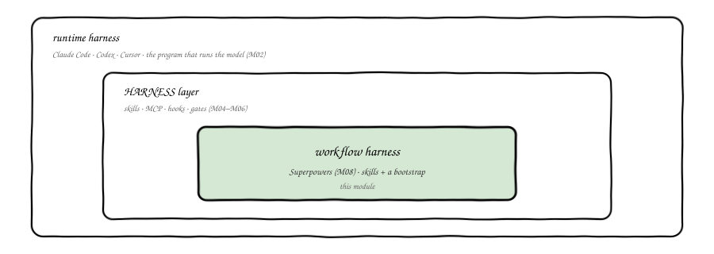
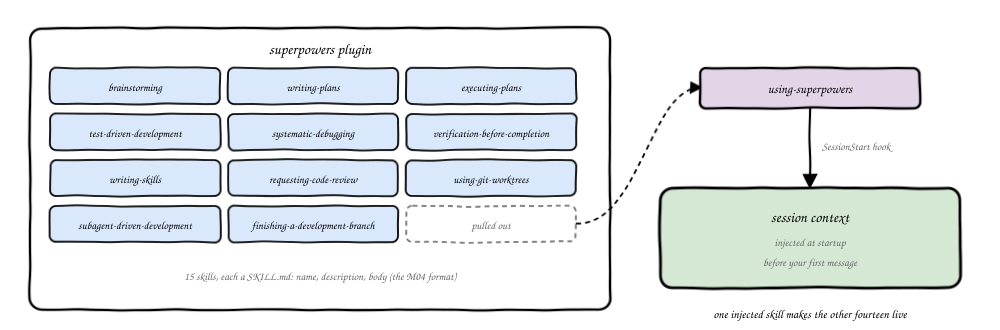
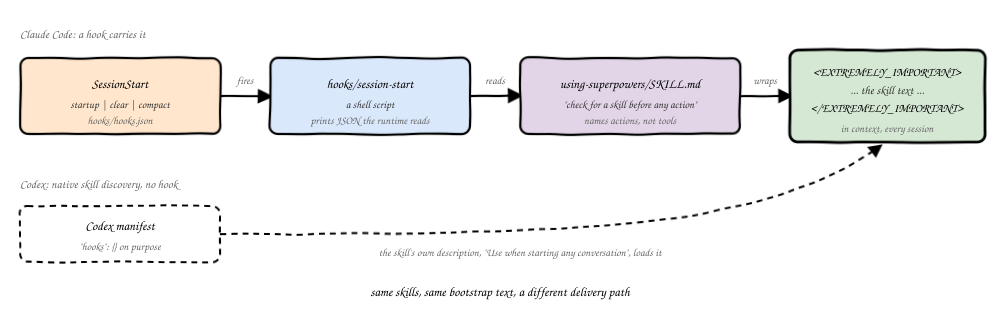
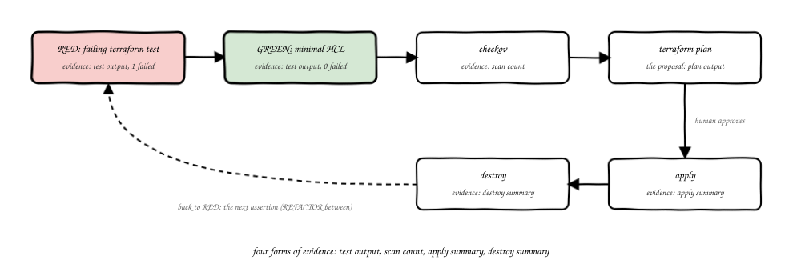
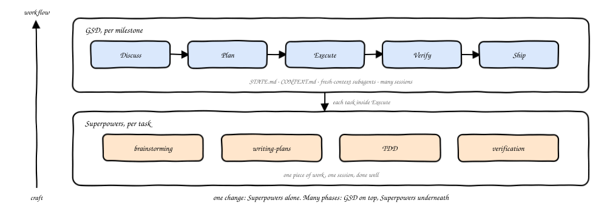
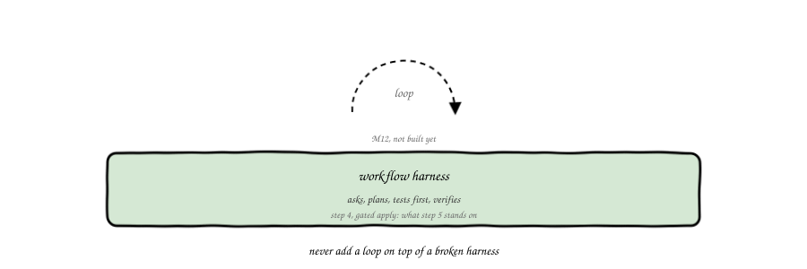

import Slides from '@site/src/components/Slides';
import Embed from '@site/src/components/Embed';

# Chapter 8: Harness Engineering

<Slides src="decks/m08-harness-engineering.html" title="M8: Harness Engineering" />

## Three Things Called a Harness

The word "harness" gets used for three different things in this field, and this module is about
the third one. Naming all three up front saves an hour of confusion later.

**The runtime harness** is the program that runs the model and hands it tools. Claude Code is a
harness. Codex is a harness. So are Cursor, Gemini CLI and the rest. When the Superpowers
documentation says "installation differs by harness", this is the sense it means. Module 2 set
these up.

**The HARNESS layer** is the middle layer of this course's three-layer model: the skills, tools,
MCP servers, hooks, sandbox and gates that sit around the agent. Module 4 gave you a skill,
Module 5 a live tool connection, Module 6 a hook that can block. The symptom that points here is
"it works, but it keeps ignoring our standards."

**A workflow harness** is a packaged set of skills plus a bootstrap that loads them into every
session, so the agent follows an engineering process whether or not it feels like it. Ask before
building. Plan before coding. Write the failing test first. Prove it before you say it is done.
That is what this module installs, and the one it installs is real: **Superpowers**, by Jesse
Vincent.

The three nest. A workflow harness runs inside a runtime harness, and it is one more thing in
the HARNESS layer. Keep that picture; the rest of the chapter stands on it.

## Superpowers: Where It Came From and What It Is

Superpowers was released on 9 October 2025, the same morning Anthropic shipped a plugin system
for Claude Code. Vincent had spent weeks extracting his own coding-agent habits into reusable
instruction files and had planned to write them up that weekend. The plugin launch moved the
date. The release post is called "Superpowers: How I'm using coding agents in October 2025", and
its one-line thesis is worth quoting: "Skills are the interesting part."

It is MIT licensed, maintained by Vincent and Prime Radiant, and installed from the official
Claude Code marketplace and the official Codex plugin marketplace. It also installs into
Cursor, Gemini CLI, OpenCode, Copilot CLI and a dozen other runtimes, from the same repository.

What you get is three things in one package:

1. **A skills library.** Fifteen skills at the pinned release, each a `SKILL.md` with a
   `name`, a `description` that says when it applies, and a body that says what to do. The
   format is the one Module 4 taught. The content is a development methodology.
2. **A bootstrap.** One skill, `using-superpowers`, is injected into every session at startup.
   It tells the agent that skills exist, that it must check for a relevant one before any
   action, and where the per-runtime tool names live. Without this one injection the other
   fourteen files are inert.
3. **A methodology.** The README calls it "a complete software development methodology for
   your coding agents." The basic workflow, in the order the README states it:

| Step | Skill | What it does |
|---|---|---|
| 1 | `brainstorming` | Fires before building anything. Draws out what you want and why. Small changes get agreed in chat; projects get a written design document |
| 2 | `using-git-worktrees` | After design approval, an isolated workspace on a new branch |
| 3 | `writing-plans` | Breaks the design into tasks with exact file paths, the test for each, and the verification step |
| 4 | `subagent-driven-development` or `executing-plans` | A fresh subagent per task with a review after each, or everything inline with one review at the end |
| 5 | `test-driven-development` | RED, GREEN, REFACTOR. "Write code before the test? Delete it. Start over." |
| 6 | `requesting-code-review` | Review against the plan, issues by severity, critical ones block |
| 7 | `finishing-a-development-branch` | Verify, then merge, PR, keep or discard |

Underneath those sit three craft skills you will use more than any of the seven:
`systematic-debugging` (no fixes without a root cause investigation first, and after three
failed fixes, question the architecture), `verification-before-completion` (no completion
claim without fresh verification evidence in the same message), and `writing-skills` (how to
add your own, and how to test it).

That second one is the discipline this whole course has been running on. "The agent proposes.
The pipeline decides." A proposal is a claim. Verification is what turns it into evidence.

## The Bootstrap Is the Whole Trick

Here is the part most people skip, and it is the part that makes a workflow harness different
from a folder of good advice.

Three files do it. `hooks/hooks.json` registers a hook on the `SessionStart` event, matching
`startup|clear|compact`, so it fires on a new session, after `/clear`, and after the context is
compacted. The hook runs `hooks/session-start`, a shell script that reads
`skills/using-superpowers/SKILL.md` and prints it as JSON in the field the runtime reads, wrapped
in an `<EXTREMELY_IMPORTANT>` block. The runtime puts that text into the model's context before
your first message arrives.

So the agent never has to remember that skills exist. Every session starts with the instruction
that it must check for one. The `using-superpowers` skill is blunt about why: "If you think
there is even a 1% chance a skill might apply to what you are doing, you ABSOLUTELY MUST invoke
the skill." It then lists the rationalizations it expects ("this is just a simple question",
"let me explore the codebase first") and rejects each one.

Two rules make the same content run on every runtime. First, **skills name actions, not tools**.
A skill says "dispatch a subagent" or "read a file", never `Task` or `Read`. The translation to
real tool names lives in `skills/using-superpowers/references/<runtime>-tools.md`. That is why
one skill body runs unchanged in Claude Code, Codex, Cursor and the rest. Second, **everything
ships through the runtime's own install mechanism**. The plugin never edits your home directory
config. If a runtime cannot carry the bootstrap through its own installer, the project says so
rather than reaching into your files.

Codex is the interesting case. It has native skill discovery and no session-start hook, so its
manifest declares an empty `hooks` object on purpose. The `using-superpowers` skill's own
description, "Use when starting any conversation", is what makes a Codex session load it. Same
skills, same bootstrap text, a different delivery path.

### Try it: the bootstrap simulator

Type the same request with the plugin off and on, and watch which tool call comes first and
which skill fires, live: [Bootstrap Simulator](pathname:///310-agentic-iac-site/sims/bootstrap-sim.html).

<Embed src="sims/bootstrap-sim.html" title="Bootstrap Simulator" />

## Adapting a Software Harness to Infrastructure

Superpowers was written for application code. Its TDD skill talks about `npm test`. None of
that changes the discipline; it changes what the words point at.

**RED** is a failing `terraform test` assertion, written before the resource is right. "The
orders table must have point-in-time recovery enabled" is a one-line assertion in a
`.tftest.hcl` file, and it fails against a bare table for exactly that reason. A Checkov check
that fails on purpose is RED too. An undeclared resource is not RED. That is an error, and the
TDD skill says to fix the error and rerun until the test fails correctly.

**GREEN** is the minimal HCL that makes the assertion pass. One block. Not the hardened version
of everything you can think of.

**Evidence** is what `verification-before-completion` asks for, and for infrastructure it has
four forms: the test output, the scan count, the apply summary, and the destroy summary. "The
table is encrypted" with none of those next to it is a guess. The skill's own table says it:
tests pass requires test command output with zero failures; "should pass" is not sufficient.

One honest finding from building this module. When we ran the same hardening task without the
harness, a current frontier model still wrote a test first and still ran the scanner before it
claimed anything. The harness did not add a discipline the model lacked that day. What it did
was make the process uniform and visible: the first tool call in the harnessed run was
`Skill superpowers:brainstorming`, every time, on every runtime, before a file was touched. A
harness earns its place by making good behaviour the default across models, days and
teammates, not by rescuing a bad model.

## Skill Versus Gate, Revisited

Module 4 drew a line: a skill suggests, a gate blocks. Superpowers sits on the skill side of
that line, and it is worth being precise about what the bootstrap changes.

The bootstrap makes the right process very hard to skip. It does not make the dangerous moment
impossible. An agent running Superpowers can still, in principle, decide a task is "too simple"
and write the resource before the test. The skill tells it not to, in capital letters, and in
practice it listens. "In practice" is still a probability.

That is why this course keeps both. The blast-radius hook from Module 6 and the scanners and
policy from Module 9 run whether or not the agent read anything. They are the pipeline. The
workflow harness is how the agent arrives at the pipeline with a plan, a test and evidence in
hand instead of a confident sentence. Each closes a gap the other cannot see.

## Harness Versus Context, Revisited

Module 1's diagnostic still applies. "Can't get one task right at all" is context, and Module 3
fixed it. "Ignores our standards" is harness. With a workflow harness loaded, that symptom gets
more specific: the standard you care about is not in a skill the bootstrap can find.

The fix is the one the harness ships with. `writing-skills` is the skill for adding a skill,
and it is stricter than Module 4 was about testing: write pressure scenarios, run them on a
subagent, and watch whether the skill holds under "the deadline is in an hour." A quiz with
the right answers in it proves nothing. That is how Superpowers' own skills were built, and it
is how you add your team's standard to the harness instead of to a wiki page.

## OpenGSD, and When to Reach for It

Superpowers runs one piece of work well. It does not keep state across sessions, it does not
track milestones, and it does not carry a roadmap. For a two-resource change that is right.
For a twelve-phase platform build across forty sessions it is not enough on its own.

**OpenGSD** ("Git. Ship. Done.") is a family of MIT-licensed tools from the open-gsd
organization. The one you would install is **gsd-core**, which its own package describes as "a
meta-prompting, context engineering, and spec-driven development system for AI coding agents."
Install it with `npx @opengsd/gsd-core@latest`; the installer asks which runtime you use and
supports Claude Code, Codex, Cursor, Copilot and others. Each milestone runs one loop: Discuss,
Plan, Execute, Verify, Ship. The heavy work in each step runs in fresh-context subagents, which
is its answer to context rot, the quality loss as a context window fills. State lives in files
the next session reads: `STATE.md`, `CONTEXT.md`, and a planning directory of roadmaps, phase
plans and verification reports. A sibling tool, **gsd-path**, runs a stricter seven-phase
pipeline whose phases produce `INTENT.md`, `SYNTHESIS.md` and `PLAN.md`, and archives each
milestone when it ships.

The decision rule:

| The job | Reach for |
|---|---|
| One change, one module, one session | Superpowers alone |
| A feature that needs a design doc and a plan, still one sitting | Superpowers, with brainstorming sizing it as a project |
| A multi-phase build across many sessions, with milestones to track | GSD on top, Superpowers underneath |

The two are not rivals. GSD carries the workflow at the project level; Superpowers carries the
craft inside each task. The repository this course was built from is run that way, and its own
design document says so in one line: "GSD carries the workflow. Superpowers carries the craft."

## What Has to Be True Before You Loop

The course's own house rule, stated in Module 1 and repeated at every layer since: never add a
loop on top of a broken harness. Module 12 teaches looping, an agent running several steps with
a human reviewing outcomes rather than every step. That only works if the harness underneath
catches what a human would have caught. A loop on top of an agent that builds before it asks
and claims before it checks just produces more of that, faster.

This module does not move you up the autonomy ladder. It is still step 4, gated apply. It is
what step 5 has to stand on.

## Vocabulary

| Term | Meaning |
|---|---|
| Runtime harness | The program that runs the model and provides its tools: Claude Code, Codex, Cursor |
| HARNESS layer | The skills, tools, MCP servers, hooks and gates around the agent; the middle layer of the three-layer model |
| Workflow harness | A skills library plus a bootstrap that makes the agent follow an engineering process in every session |
| Superpowers | Jesse Vincent's workflow harness for coding agents, released 9 Oct 2025, MIT, on the official marketplaces |
| Bootstrap | The SessionStart hook that injects `using-superpowers` into every session; on Codex, native skill discovery does the same job |
| Tool mapping | The per-runtime file that translates a skill's action words into real tool names |
| `verification-before-completion` | No completion claim without fresh verification evidence in the same message |
| `writing-skills` | How to add a skill to the harness and test it with pressure scenarios on a subagent |
| `terraform test` | Terraform's native test runner; `.tftest.hcl` files with `run` blocks and `assert` conditions |
| OpenGSD | "Git. Ship. Done." A family of tools for milestone-level agentic development; gsd-core is the installable one |
| Context rot | Quality loss as a context window fills; GSD's reason for fresh-context subagents |
