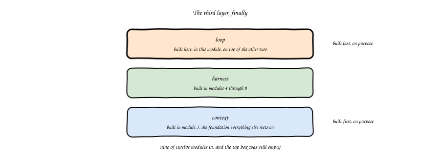
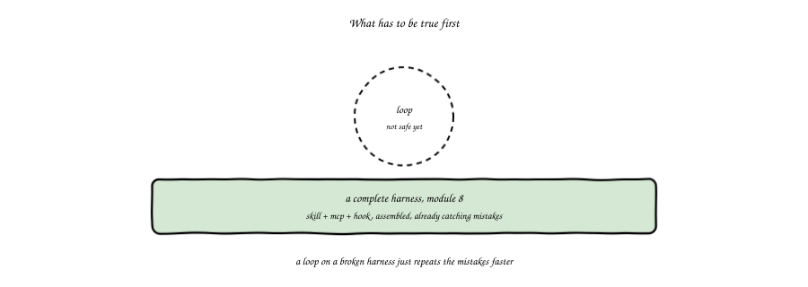
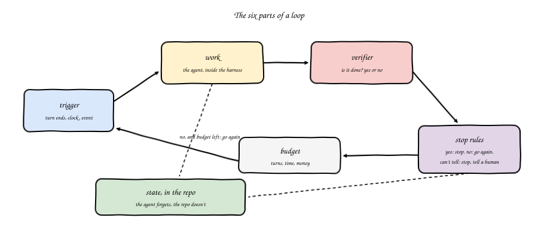
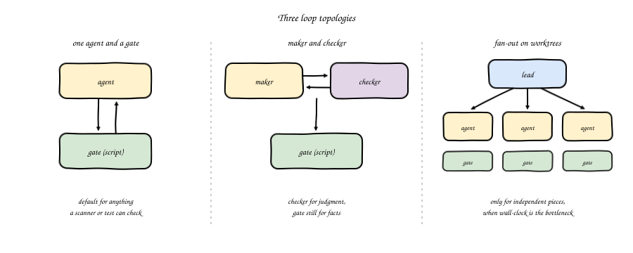
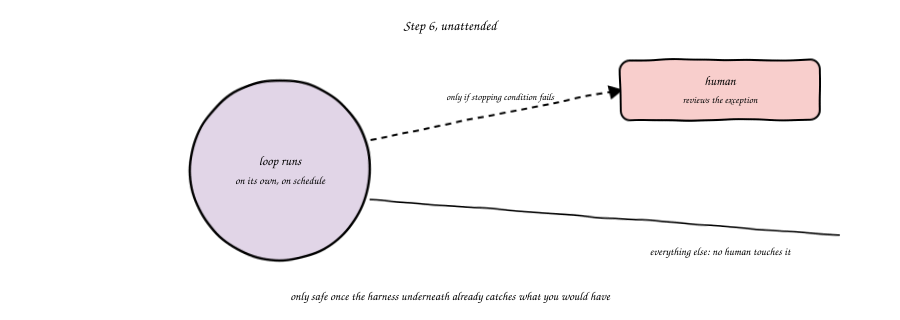
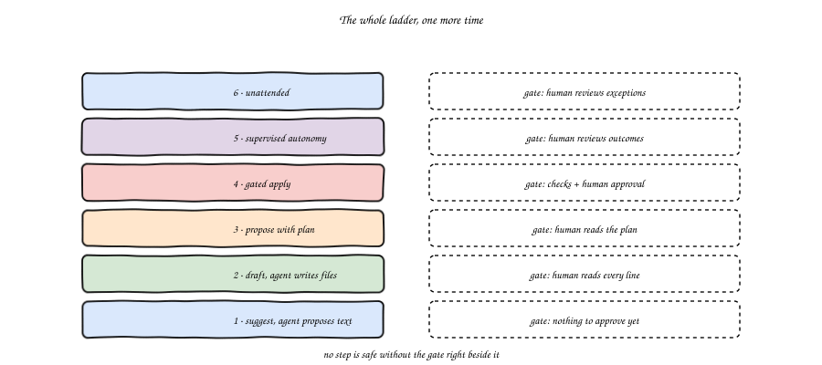

import Slides from '@site/src/components/Slides';
import Embed from '@site/src/components/Embed';

# Chapter 12: Loop Engineering for Infrastructure Agents

<Slides src="decks/m12-loop-multiagent-economics.html" title="M12: Loop Engineering for Infrastructure Agents" />

KiranaKart's compliance policy says no credential ever lives in a Terraform file. Nobody
disputes the rule. The trouble is that nobody checks it, night after night, on code that
changes every day. Last month a contractor pasted an access key into a config template to
unblock a deploy, and the first person to notice was an auditor, three weeks later, asking
why nobody caught it sooner. The honest answer is that nobody was watching, because
watching every night, by hand, is not a job any person wants.

The team already has an agent that can fix this kind of thing. Somebody types a request, the
agent edits the file, somebody reads the result. What they do not have is the agent doing it
on its own, every night, and stopping only when the job is really done. That missing piece
has a name now. Developers who use coding agents every day started calling it loop
engineering in the summer of 2026. This chapter teaches it the way they practise it. Then it
adds the one thing infrastructure needs that a coding loop can get away without.

This book opened with three layers and asked us to build them bottom-up: context, then
harness, then loop. We have spent eleven chapters on the first two. This is the chapter where
the third one gets built. It is also where the six-step ladder this book has tracked since its
first chapter closes, all the way to the top.

In this chapter we will cover the following:

- Where loop engineering came from, and what its practitioners mean by it
- The parts every loop has, and the four primitives Claude Code and Codex give us to build one
- Why the agent's own transcript should never be the thing that decides "done" for
  infrastructure, and what decides it instead
- How to arrange more than one agent inside a loop, and when not to
- What a loop costs, measured on this chapter's own runs and on a published paired benchmark
- Where every one of this book's six autonomy steps got built

## Technical Requirements

You need `terraform` and `checkov`, the same tools every Tier 0 chapter in this course has
used, plus both agent CLIs from Chapter 2 and Python 3 with the `PyYAML` package. The module
under the loop is a small Terraform configuration with the `local` provider, so no cloud
account is involved. Exact versions live in this module's `README.md` and in the book's Appendix A, and the runnable version of every
step is in the companion repository under `modules/module-12-loop-multiagent-economics/`.

We need no cloud account here, no cluster, and no paid API. This is a Tier 0 chapter, the same
free tier the book opened with.

## The Third Layer, and What a Loop Is

Go back to Chapter 1's own diagnostic. Three layers, one table. Context: the agent cannot get
one task right at all. Harness: it ignores our own standards. Loop: we babysit every single
run.

Chapter 3 built context. Chapters 4 through 8 built the harness, piece by piece: a skill, a
live tool connection, a hook, a workflow harness that makes the agent plan, test first and
show evidence. The loop layer sat untouched the whole time.

It comes last on purpose. It is not harder than the other two. It is the one layer we should
never build first. A loop repeats whatever sits underneath it, mistakes included, faster than
a person would. Build it on a broken harness and we get more damage, sooner. Build it on what
Chapters 3 through 8 gave us, and the loop itself turns out to be a small piece of work.



As the figure above shows, the loop is the top of the stack, and it rests on everything
beneath it. A loop sitting on a shaky harness does not stay contained. It repeats the
harness's own mistakes, over and over, faster than any one run would have.



The figure above states the rule this whole book has been building toward: never add a loop
on top of a harness we have not proven yet.

So what is a loop, in the sense people mean it today? The shortest honest definition is a
system that prompts the agent for us. We stop typing the next instruction. Something else
types it, again and again, until a condition we wrote down is true. That something else is
what we are about to engineer.

## Where Loop Engineering Came From

Unlike some ideas in this book, this one has a traceable history, and it is short.

In July 2025 Geoffrey Huntley published a post called "Ralph Wiggum as a 'software engineer'".
His technique fitted on one line: a shell loop that fed the same prompt file to a coding agent,
forever.

```
while :; do cat PROMPT.md | claude-code ; done
```

"Ralph is a technique," he wrote. "In its purest form, Ralph is a Bash loop." Each pass did
one task, left its work in files and in git, and exited. The next pass started with a fresh
context and read what the last one left behind. The name was a joke about persistence despite
setbacks. The idea stuck because it worked better than anyone expected.

Anthropic then shipped Ralph as an official Claude Code plugin, `ralph-loop`, in its plugin
marketplace. It moved the loop inside the session. A Stop hook catches the agent each time it
tries to finish and feeds the same prompt back. That goes on until the agent prints an agreed
completion phrase or an iteration limit runs out. In the spring of 2026 both major agent CLIs turned the
idea into a built-in command. Codex shipped a persisted `/goal`, and Claude Code shipped its
own `/goal`. Each one keeps the agent working, turn after turn, until a stated condition is
met.

The name arrived in June 2026. On 7 June, Peter Steinberger posted: "You shouldn't be
prompting coding agents anymore. You should be designing loops that prompt your agents." The
same day, Addy Osmani published an essay titled "Loop Engineering" that gave the practice an
anatomy. His loop has five working parts. Automations run on a schedule. Worktrees keep parallel
work apart. Skills hold project knowledge. Connectors reach existing tools. And sub-agents split
the work, so one proposes and a different one checks. Underneath sits a sixth piece,
state that lives outside the conversation. "The agent forgets," he wrote, "the repo doesn't."
Later that month Andrew Ng described three loops running at different speeds in The Batch. An
agentic coding loop is measured in minutes. A developer feedback loop is measured in hours. An
external feedback loop is measured in days.

Two things are worth taking from that history. First, every one of those people is describing
the same mechanism we have used since Chapter 1: a trigger that re-runs the agent, and a
condition that stops it. Second, all of them were writing about application code, where the
cost of a wrong "done" is a failing test tomorrow. For infrastructure the cost is a credential
in production or a deleted bucket. That difference is what most of this chapter is about.

## The Parts of a Loop

Strip the vocabulary away and every loop in that history has the same six parts. We will name
them once, because the rest of the chapter refers back to them.



As the figure above shows, the **trigger** is what starts or restarts the agent: the previous
turn ending, a clock, an event such as a pull request opening. The **work** is the agent doing
the task with the harness we already built. The **verifier** answers one question, is the job
done, with a yes or a no. The **stop rules** decide what happens next: stop on yes, go round
again on no, and stop anyway when something cannot be decided. The **budget** caps how many
times round, how long, or how much money. The **state** is what the loop remembers between
runs, kept in the repository rather than in any one conversation.

Miss the trigger and we have a single good run that happened once. Miss the verifier and we
have a process that runs until someone notices and kills it. Miss the budget and a loop that
cannot succeed keeps spending until the month ends. A real loop has all six, every time.

## Four Primitives, Two Runtimes

Claude Code and Codex now ship the pieces to build that cycle without writing a scheduler. They
differ in names more than in ideas. What separates them is what starts the next turn.

| Primitive | Next turn starts when | Claude Code | Codex |
|---|---|---|---|
| Goal | the previous turn ends and a judge says "not yet" | `/goal <condition>` | `/goal` |
| Stop hook | the previous turn ends and your script says "not yet" | `Stop` in `.claude/settings.json` | `Stop` in `.codex/hooks.json` |
| Interval loop | a fixed or self-chosen interval passes, in an open session | `/loop 15m <prompt>` | an automation in the app |
| Schedule | a clock fires, with no session open | routines, Desktop tasks, GitHub Actions | automations, GitHub Actions |

The first two keep one session working toward an end state. The last two decide when a session
runs at all. A nightly compliance loop needs both: a schedule to wake it, and a stopping rule so
that each run finishes the job rather than the first pass at it.

`/loop` deserves one plain warning. It lives inside an open session. Close the terminal and the
loop stops, and the documentation says recurring tasks expire after seven days on their own.
That is the right tool for watching a build while we work. It is the wrong tool for a control
that has to run on the nights nobody is at a desk.

## Who Decides "Done"

Here's the part that would surprise most people. In both of the popular in-session loops, the
agent's own words decide when the loop ends.

`ralph-loop` stops when the agent prints the completion phrase we agreed on, such as `DONE`.
The agent decides when to print it. `/goal` is more careful: after each turn a separate, small
model reads the conversation and judges whether the condition holds. That is a real
improvement, because the judge is not the model that did the work. But the documentation is
precise about its limit. The evaluator "doesn't run commands or read files independently". It
judges only what the agent chose to show in the transcript.

For application code that trade is often fine. For infrastructure it is the exact pattern
Chapter 1 warned about, a task getting done and the agent reporting success being two separate
events. A transcript that says "checkov passes" is a claim about the scanner, not a run of it.


The figure above puts the three side by side, and the third column is this chapter's
contribution. We keep the agent, the trigger and the loop. We replace the judge. A Stop hook
runs a script, and the script runs the real scanner against the real files and returns an exit
code. Zero means done. Anything else sends the agent back to work with the scanner's own
findings as its next instruction. The agent cannot talk its way past an exit code, and a second
hook stops it from editing the script that produces one.

That is the course's thesis, the agent proposes and the pipeline decides, applied to the loop
layer. The pipeline we built in Chapter 9 decided whether a change could merge. Now a small
piece of it decides whether the agent is allowed to stop.

> **Where this sits on the ladder.** A gated loop like this one is how step 5, supervised
> autonomy, works in practice: the agent runs without anyone approving each step, and a person
> reviews the outcome. It is also the floor step 6 stands on, later in this chapter.

### Try It: Who Decides "Done"?

Open `explainer/sim/stopping-condition-sim.html` in a browser. Pick a judge (a completion phrase,
the `/goal` evaluator, or the Stop gate), pick a situation (a narrow ticket, a missing scanner, a
finding the agent cannot fix), and run the loop. After every run the sim checks the working copy
independently. Find the judge that says "done" while a key is still in the repository.

## Loop Topology: One Agent or Several

Osmani's anatomy includes sub-agents for a reason. Some loops work better with more than one
agent in them, and the arrangement is a design choice like any other. Three arrangements cover
most of what a team will need.



As the figure above draws them, the simplest is **one agent and a gate**. One session does the
work and a script decides "done". For anything a scanner, a test, a plan or a policy can check,
this is the right default. It is cheap, it is easy to debug, and the judge is deterministic.

The second is **maker and checker**. One agent proposes and a different agent reviews, and the
reviewer's verdict decides. Osmani's essay names this as the main safeguard in a loop. It earns
its cost on the questions a script cannot answer: is this module structured the way the team
structures modules, is this plan the change the ticket asked for. For infrastructure, use the
checker for judgment and keep the gate for facts. A second model agreeing that a scan passed is
still not a scan.

The third is **fan-out**. A lead splits a large job into independent pieces and hands each to
its own agent, on its own git worktree so two agents never edit the same file. Claude Code's
agent teams, currently experimental and switched off by default, work this way, with a shared
task list and teammates that message each other. They also carry the same gate idea down to each
teammate. A `TaskCompleted` hook that exits with code two refuses to mark a task done, exactly
as our Stop hook refuses to let a session end. The documentation is blunt that teams use
significantly more tokens than a single session, and that they suit work whose pieces can run
independently.

Here is a concrete criterion. Fan out only when the pieces truly do not depend on each other,
and when one agent's wall-clock time, not its correctness, is the bottleneck. Add a checker only
for questions that need judgment. Everything else stays one agent and a gate. For most
infrastructure loops, everything else is most of the work.

## Step 6, Unattended, and the Second Kind of Agent

Chapter 1 made a promise. Most of this book would cover coding agents, since an infrastructure
change is naturally a short repository task. It also said we would meet a second kind: agents
that watch running infrastructure over time instead of editing it once, and that Chapter 12 was
where they would show up.

A scheduled, gated loop is that second kind. It wakes on a clock, reads live evidence, compares
it against a written policy, and acts only inside a bounded set of actions. In this chapter's
build the bounded action is narrow on purpose: the agent may edit the working copy, and the
result goes to a human as a proposed change. Nothing applies on its own. Its risk does not come
from which files it can edit. It comes from how often it runs without anyone watching.



> **Where this sits on the ladder, step 6, unattended.** As the figure above draws it, no human
> approves each run. A person appears only on an exception: the loop ran out of budget, or the
> verifier could not reach a verdict. Step 6 works only because of what came before it. A gate,
> from Chapter 6. A workflow harness, from Chapter 8, that makes the agent plan, test first and
> show evidence. A real pipeline, from Chapter 9. Without all three, "unattended" just means
> "unsupervised", and that is not a step up the ladder. It is a step off the edge of it.

This course never teaches step 6 as a default. It teaches what has to be true first, and leaves
the decision, task by task, to the team running it.

## What a Loop Costs

A loop is not free just because nobody is watching it. Every turn is tokens, and a loop that
cannot succeed keeps spending until something stops it. Three kinds of evidence belong here.

The first is this chapter's own runs. Claude Code reports the turns, the duration and the cost of
every headless session in its own event stream, and the lab's `trace.py` reads them back. These
are the runs behind the next section, all on 25 October 2026, three of each kind:

| Judge | Runs | Turns | Times sent back | Cost per run, USD |
|---|---|---|---|---|
| `/goal`, a model reading the transcript | 3 | 18, 18, 8 | 4, 8, 0 | 40, 38 and 22 cents |
| Stop hook running `verify.sh` | 3 | 9, 7, 11 | 1, 1, 1 | 30, 23 and 26 cents |

Every one of the six runs ended with a clean independent check, so both kinds of loop did the work.
The difference is in what it took. The gated loop sent the agent back exactly once every time, for
the same reason, and cost about the same each run. The model-judged loop ranged from zero returns
to eight, and the next section shows why. Three runs of each is enough to see a pattern, not to
prove one, and the lab asks you to run your own.

The second is the published evidence on tools that claim to cut that cost. JetBrains ran paired
A/B benchmarks in July 2026, the same tasks with and without each tool, on Claude Code against
the SkillsBench task set. The caveman skill, which advertises a saving of 65 percent, measured a
saving of 8.5%. The rtk command rewriter, which advertises 60 to 90 percent, made each
task about 7.6% more expensive at low reasoning effort, across 80 clean pairs, and made
no measurable difference at high effort. Task quality did not change in either arm. That is the
measurement Chapter 3 promised, and it lands where Chapter 3 said it would: smaller than the
marketing page, and in one case the wrong direction entirely.

The third is the loop's own budget, which is the only cost control a loop runs without a person.
Our Stop gate counts its own blocks in the loop's state file and releases the agent after five,
recording "budget exhausted" rather than "done". Claude Code adds a hard limit of its own: after
eight Stop-hook continuations in a row with no tool use between them, it overrides the hook and
ends the turn.

Chapter 9 put a cost stage in its pipeline. This chapter's lab adds a smaller check worth naming
on its own: the FinOps gate, a deterministic policy check that reads a Terraform plan already on
disk. Too many resources, a missing required tag, an instance type outside an allowed list: each
fails the gate the way a scanner fails a plan, with no account and no API key. It is a verifier
like `verify.sh`, and it can sit in the same Stop gate for any loop that produces plans.

## Seeing It Work

Theory earns its place once a real agent runs inside a real loop, tries to stop early, and gets
sent back by something it cannot argue with. Let's build it.

Everything below runs on your own machine. The module under the loop is a small Terraform
configuration for a log-shipping sidecar. It has two hardcoded AWS keys, one as a variable
default in `main.tf` and one inside a config template in `shipper.tf`. That second file is the
point of the exercise.

We start with the stopping condition, because it is the first thing to build and the last thing
the agent is allowed to touch. The lab's `verify.sh` answers one question with three exits: zero
for done, one for not done with the findings on standard error, two for no verdict when a tool is
missing or Terraform cannot initialise. It also treats a `checkov:skip` comment as not done,
because a suppression is not a fix. One script copies it and both hooks into a working copy:

```console
$ bash lab/loop/install.sh work
$ bash loop/verify.sh; echo "exit $?"
```

```console
NOT DONE: checkov still reports failed checks:
Check: CKV_SECRET_2: "AWS Access Key"
	FAILED for resource: abac545fc3bf803134bc8f78fb6160a5c6a87b26
	File: /main.tf:15-16
Check: CKV_SECRET_2: "AWS Access Key"
	FAILED for resource: dd2709fa7eee829995341383d3a22fc137c72987
	File: /shipper.tf:7-8
exit 1
```

Two findings, two files.

### A Loop the Model Judges

First, the popular way. On a fresh copy with no hooks, we hand the job to `/goal`:

```console
$ claude -p "/goal The hardcoded AWS key for the log shipper is out of main.tf, and checkov reports no failed checks for this directory. Stop after 6 turns."
```

The full command, with its permission flags, is in `LAB.md` Stage 2.

The evaluator sent the agent back four times. The first return was fair. The agent's rerun of
Checkov printed only a banner with no summary line, so the transcript did not show the condition
holding, and the agent had to prove it. The other three were caused by four words. "Stop after 6
turns" was written as part of what must be true. The agent went past six turns proving the rest,
and the condition could never hold. The agent said as much in its last message: "The goal also said
to stop after 6 turns, and I've already gone past that. Every reply I make adds another turn, so the
Stop hook will keep blocking."

The documentation suggests writing a budget as an alternative, "or stop after 20 turns", not as a
requirement. The bigger lesson is that a model judge reads words, so every word in the condition is
part of the gate. Our own `verify.sh`, run afterwards, said done. The work was right, and the loop
spent 18 turns arguing about it.

### A Loop the Pipeline Judges

Now the same starter with the loop installed, and a narrow request, the way tickets are usually
written:

```console
$ claude -p "The log shipper's AWS key is hardcoded as the variable default in main.tf. Take it out of main.tf."
```

The full command is in `LAB.md` Stage 3.

The agent did exactly what it was asked, fixed `main.tf`, and tried to stop. The gate ran the
scanner and sent it back with the scanner's own finding as its next instruction:

```console
verify.sh says the work is not done. Fix these, then stop again:
NOT DONE: checkov still reports failed checks:
Check: CKV_SECRET_2: "AWS Access Key"
	FAILED for resource: dd2709fa7eee829995341383d3a22fc137c72987
	File: /shipper.tf:7-8
```

The agent fixed `shipper.tf`, and this time the gate let it stop. Its final message is the whole
chapter in two lines: "You'd scoped this to `main.tf`, but the stop hook wouldn't let me finish while
`shipper.tf` still had a key." The loop's state file records both verdicts, with timestamps, so
nobody has to read a transcript to know how the run ended.

### The Same Loop in Codex

The same two hooks, registered in `.codex/hooks.json`, run in Codex unchanged. The first run did
not show that. We ran `codex exec` before trusting the hooks, and the agent fixed `main.tf`,
reported done, and stopped. There was no state file. The second key was still there. Codex runs a
project hook only after someone trusts it, and in non-interactive mode it skips an untrusted one
without a word. Starting Codex interactively shows the prompt:

```console
  Hooks need review
  2 hooks are new or changed.
  Hooks can run outside the sandbox after you trust them.
```

After a review and a trust, the same request ran again. Codex noticed the second key, said it was
leaving it, and tried to stop. The gate refused, the agent fixed it, and the state file shows one
block and one done. One more detail is worth knowing. Inside its sandbox the agent could not run the
verifier itself, because `terraform init` needs the network. The hook runs outside the sandbox, so
the gate could.

### Putting the Loop on a Clock

Last, the trigger the opening story needed. On a clean copy, in an interactive session, we asked
for a two-minute loop:

```console
/loop 2m Run loop/verify.sh and report its verdict in one line. If it prints NOT DONE, fix exactly what it names, run it again, and report what changed.
```

Our first attempt said "say so in one line and stop". Claude read "stop" as being about the loop,
not about one run, and never scheduled anything. A per-run prompt describes one run. It never tells
the loop to end.

With the loop running, we committed what the contractor did in the opening story, a key pasted back
into the template. Within two minutes the next run found it, fixed it, and added something no script
would have: the key is still in that commit, so it has to be rotated, not just removed. The run after
that found nothing to do and said so. Closing the session ends the loop. That is why the lab's
nightly version is a GitHub Actions workflow. It runs the same gated session on a schedule, judges
the job by the state file, and hands the diff to a human rather than pushing it.

### What the Runs Cost

The lab's `trace.py` reads each run's own accounting:

```console
$ python3 ../lab/loop/trace.py run.jsonl
```

The FinOps gate from the previous section runs against plan fixtures the same way it always has:

```console
$ python3 finops/gate.py finops/plan-over-budget.json
```

## Under the Hood

A Stop hook is a small contract, and it is the same contract in both runtimes. When the agent
finishes a turn, the runtime runs our command and writes a JSON object to its standard input. It
carries the session, the transcript path and the last assistant message. It also carries a flag
called `stop_hook_active`, which is true when the turn is already a continuation caused by a Stop
hook.
Our command then answers in one of two ways. It exits with code zero, and the agent stops. Or it
exits with code two and writes a reason to standard error, and the agent does not stop. The
reason becomes its next instruction. Codex uses the same exit code and the same idea, and it also
accepts a JSON reply with a `decision` of `block` and a `reason`.

Three details matter more than they look.

The gate ignores the transcript on purpose. Our `stop-gate.sh` reads its input and throws it
away, then asks the repository. That is the whole difference from `/goal`. The evaluator there
receives the conversation. Ours receives a working copy and a scanner.

The gate has three outcomes, not two. Done lets the agent stop. Not done sends it back. No
verdict, a tool missing or `terraform init` failing, lets the session end and records the fact,
because sending an agent back to fix a broken scanner it cannot see is a loop with no exit. The
loop's state file shows which of the three ended each run, so nobody has to read a transcript to
know.

Trust is part of the gate. Codex will not run a hook it has not been told to trust, and it
records that trust against a hash of the hook. Change the hook and it has to be trusted again.
That is a good property. A gate that can be edited without anyone noticing is not a gate. But it
also means a fresh checkout runs the agent with no gate at all until someone reviews the hook,
and in non-interactive mode it says nothing about it. The lab shows exactly that happening.

## When This Goes Wrong

Every row below started as a real case in this chapter's build.

| Seeded failure | Caught by | Fixed by |
|---|---|---|
| The agent is asked about one file and fixes only that one, while a second key sits in another file | The Stop gate, running the scanner across the whole working copy | The agent, sent back with the scanner's own finding as its next instruction |
| A request says suppressing a finding is fine | The verifier, which treats any `checkov:skip` comment as not done | Fixing the finding, not hiding it |
| The agent edits the verifier or the hook to make the loop end | The guard hook, refusing edits under `loop/`, `.claude/`, `.codex/` and `.loop/` | Nothing to fix; the edit never happens |
| A Codex hook was never trusted, so the gate silently did not run | The loop's state file, empty after the run | Trusting the hook with `/hooks`, then checking the state file after every run |
| A tool the verifier needs is missing or a provider block is broken | The verifier's "no verdict" exit | Ending the run and recording it for a human, never treating a scan that did not run as clean |
| A loop that cannot succeed keeps going round | The gate's block counter and Claude Code's continuation cap | Releasing the agent as "budget exhausted", never as "done" |
| A plan carries too many resources, a missing tag, or a disallowed instance type | The FinOps gate, reading a plan already on disk | Correcting the plan to match policy |
| A team assumes step 6 is safe because a loop exists | Nothing, by construction | Proving the gate, the harness and the pipeline first |

The fourth row deserves more weight than a table row usually carries. A gate that does not run
looks exactly like a gate that passed, unless the loop writes down what it decided. That is why
our gate writes a line to `.loop/state.md` on every outcome, and why the scheduled version of
this loop colours its job from that file rather than from anything the agent said.

## Where You Will Use This

**A recurring compliance check nobody owns.** The gap between a written policy and an enforced
one is usually a missing loop, not a missing rule. If a scanner, a test or a policy can check the
rule, wrap it in `verify.sh`, give it to a Stop gate, and put the loop on a schedule.

**Reviewing a loop someone else built.** Ask one question first: what decides "done"? If the
answer is a phrase the agent prints or a model reading the transcript, ask what checks the
infrastructure itself. If nothing does, the loop is a well-organised way to accept claims.

**Choosing a topology.** One agent and a gate, unless a question needs judgment, then add a
checker. Fan out only when independent pieces make wall-clock time the bottleneck.

**Evaluating a cost claim.** Any tool that advertises a percentage, on tokens or on anything
else, is making a claim this chapter's discipline applies to. Ask for the paired measurement,
the date and the sample size, then read your own loop's cost from its own event stream.

## Summary

In this chapter, we built the third and final layer of this book's diagnostic: the loop. We saw
where loop engineering came from, from Huntley's one-line shell loop in 2025 to Steinberger's and
Osmani's naming of it in June 2026, and the six parts every loop has. We mapped them onto the four
primitives both agent CLIs now ship: a goal, a Stop hook, an interval loop and a schedule.

We found the one place where infrastructure parts company with application code. The popular
in-session loops let the agent's own transcript decide "done". For infrastructure we replaced
that judge with a script that runs the scanner against the files, wired it as a Stop hook in
Claude Code and in Codex, and protected it with a guard hook. We watched it send a real agent
back for a credential the agent had not been asked about, and we watched an untrusted hook skip
silently.

We chose loop topologies on the grounds that decide between them. We reported this chapter's
own loop costs alongside a published paired benchmark. And we reached step 6 on the ladder, with
what has to be true first stated plainly.



The figure above closes the ladder this book opened in Chapter 1. Every step has a gate beside
it, and every gate was built in a chapter before the step it protects. The capstone is where all
of it runs together, on one spec, front to back.

## Further Reading

- Geoffrey Huntley, "Ralph Wiggum as a 'software engineer'", ghuntley.com, 14 July 2025, the
  original Ralph loop.
- Addy Osmani, "Loop Engineering", addyosmani.com, 7 June 2026, the anatomy this chapter uses.
- Andrew Ng, The Batch, June 2026, the three loops: agentic coding, developer feedback and
  external feedback.
- The Claude Code documentation pages on `/goal`, on hooks and on scheduled tasks, for the exact
  behaviour of the evaluator, the Stop hook contract and `/loop`.
- The Codex documentation page on hooks, for the Stop event and hook trust.
- JetBrains AI blog, July 2026, the paired benchmarks of the caveman skill and the rtk command
  rewriter.
- The companion repository, `modules/module-12-loop-multiagent-economics/lab/`, for the
  verifier, the hooks, the captured runs and the nightly workflow example.

## Vocabulary

| Term | Meaning in this module |
|---|---|
| Loop engineering | Designing the system that prompts the agent for us: what re-invokes it and what makes it stop. Named in June 2026 |
| Ralph loop | Geoffrey Huntley's July 2025 technique: a Bash loop that feeds the same prompt file to a coding agent, forever |
| `ralph-loop` | Anthropic's Claude Code plugin that moves Ralph inside the session with a Stop hook; ends on a completion phrase or an iteration limit |
| `/goal` | A built-in command in Claude Code and Codex; after each turn a small model reads the transcript and judges whether the condition holds |
| Stop hook | A command the runtime runs when the agent finishes a turn; exit 0 lets it stop, exit 2 sends it back with standard error as the next instruction |
| Verifier | The part of the loop that answers "is it done?"; here `loop/verify.sh`, with three exits |
| No verdict | Exit 2 from `verify.sh`: a tool is missing or Terraform cannot initialise, so nothing can be concluded |
| Guard hook | A PreToolUse hook that refuses edits under `loop/`, `.claude/`, `.codex/` and `.loop/`, so the agent cannot edit its judge |
| Loop state | `.loop/state.md`, one line per gate outcome, kept in the repository rather than in any conversation |
| Budget | The cap on times round, time or money; the gate releases the agent as "budget exhausted" after five blocks |
| Topology | How agents are arranged inside a loop: one agent and a gate, maker and checker, or fan-out on worktrees |
| Step 6, unattended | The top of the autonomy ladder: no human approves each run; a person appears only on an exception |

<Embed src="sims/stopping-condition-sim.html" title="Who Decides Done" />
